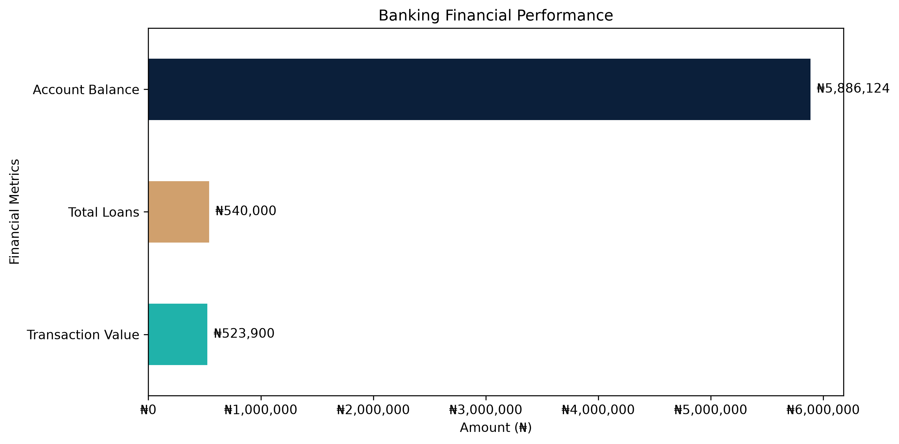
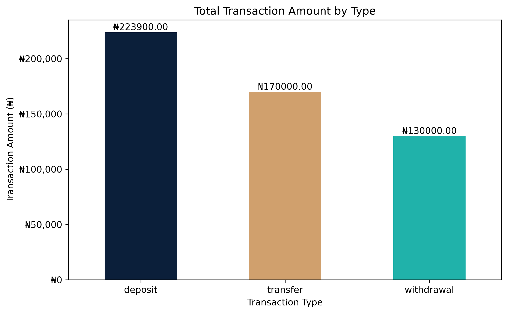
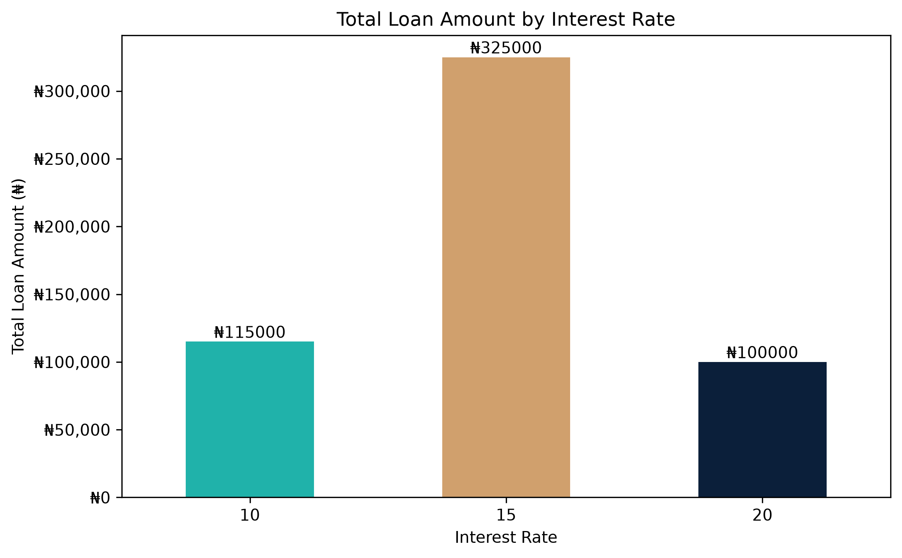
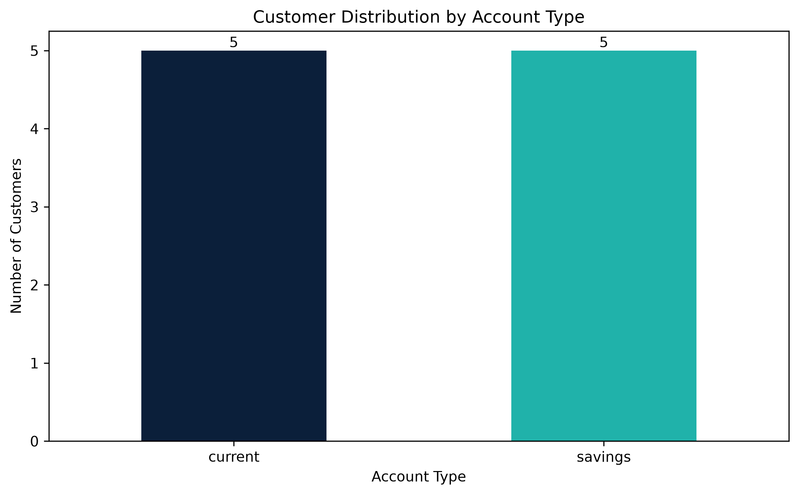
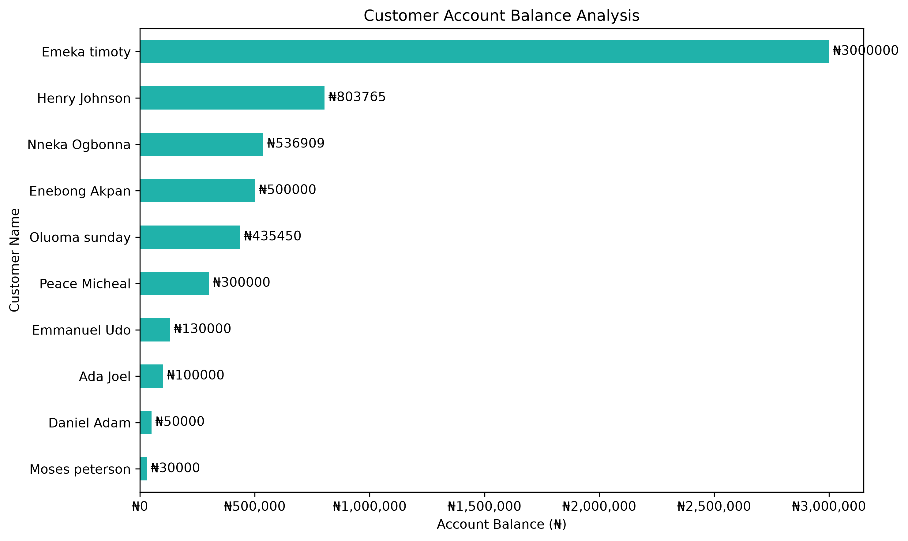
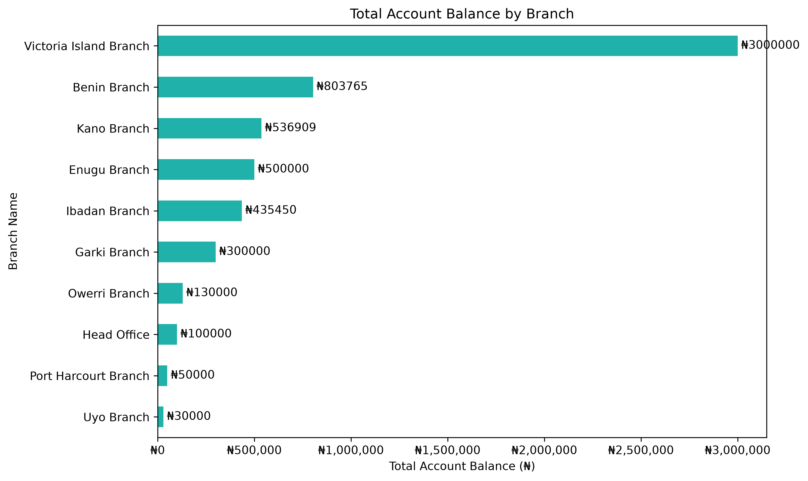

# Banking Data Analysis Using Python

## Project Overview
This project focuses on analysing a banking database using Python to uncover insights about customer accounts, transactions, loans, and branch performance.

The analysis was performed using data retrieved from a MySQL database and processed with Python libraries.

## Tools and Technologies
- Python
- MySQL
- Jupyter Notebook
- Pandas
- NumPy
- Matplotlib

## Project Objectives
- Analyse customer account balances.
- Examine transaction types and values.
- Evaluate loan distribution by interest rate.
- Compare account balances across branches.
- Identify key banking performance indicators.
- Present findings through clear visualisations.

## Key Findings
- Total customers: 10
- Total accounts: 10
- Total account balance: ₦5,886,124
- Total transaction value: ₦523,900
- Total loan amount: ₦540,000
- Current accounts hold approximately 74.17% of total account balances.
- Deposits recorded the highest transaction value at ₦223,900.
- Loans at a 15% interest rate accounted for approximately 60.19% of total loan value.
- Victoria Island recorded the highest account balance at ₦3,000,000.

## Project Files
- `python banking analysis.ipynb` – Jupyter Notebook containing the analysis.
- PNG chart files – Visual representations of the analysis and findings.

## Limitations
The dataset contains 10 customers, 10 accounts, and 10 transactions. Therefore, the findings represent this sample dataset and should not be treated as a complete picture of a real bank's operations.

## Conclusion
This project demonstrates how Python, SQL, and data visualisation can be used to analyse banking data, identify patterns, and communicate business insights.

## Jupyter Notebook

Explore the complete Python analysis, including data cleaning, exploratory data analysis, calculations, business insights, and visualisations.

[View the Complete Python Banking Analysis Notebook](python%20banking%20analysis.ipynb)

## Data Visualisations

The following charts present the key findings from the banking data analysis.

### 1. Banking Financial Performance

### 2. Account Balance by Account Type
.png)

### 3. Transaction Analysis

### 4. Loan Analysis

### 5. Customer Account Analysis

### 6. Customer Balance Analysis

### 7. Branch Balance Analysis

### 8. Customer Transaction Activity

**Author:** Emmanuel Best Maobughichi
		Data Analyst
